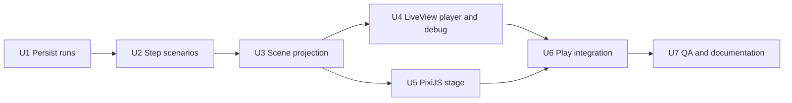

# PixiJS Jido Work System Simulation

## Goal Capsule

- Objective: Let a person select a Jido Work System scenario and watch, pause, step, and guide the work through a simple game-like office scene.
- Means: Keep work state on the Phoenix server. Add persisted scenario runs, deterministic one-beat execution, a versioned scene projection, and a PixiJS v8 canvas in a LiveView hook.
- Authority: Local implementation in this spike only. Do not commit, push, publish, or change another Jido package without separate authority.
- Stop conditions: Stop if implementation requires a general workflow language, production security, changes to `jido_vsm`, or client ownership of domain state.
- Next executor: A Phoenix and JavaScript implementer working in this spike.

## Product Contract

### Summary

The existing screen is a useful debug view, but it shows the complete simulation after all work is done. Add a simpler play view. A person selects a scenario, starts a run, and moves through the work one beat at a time. PixiJS shows people, work cells, task handoffs, evidence, verification, rework, and acceptance. The detailed resource view stays available for the same run.

### Problem Frame

The current simulation proves that the resource model can record a complete success or rework path. It does not show how work moves through the system. `JidoWorkSystem.Simulation.run/1` resets all data and completes the selected path in one call. `JidoWorkSystemWeb.SimulationLive` then renders the final snapshot. A user cannot select a named scenario, inspect an intermediate state, pause at a decision, or see a direct visual model of the work.

### Actors

- Player: Selects a scenario and controls step, play, pause, restart, and human decisions.
- Accountable human: Defines work, delegates it, and accepts, rejects, or requests revision.
- Work cell: Receives delegated work and performs bounded actions.
- Verifier: Checks evidence independently from the work cell and human acceptance.
- Debug user: Opens the detailed resource and event view for the current run.

### Requirements

- **R1 — Scenario selection:** The play view lists at least `Straight-through release` and `The missing risk section`, with a short goal and expected learning point for each scenario.
- **R2 — Isolated run:** Starting a scenario creates a persisted run with its own work system, cursor, status, and scene revision. Starting or restarting one run does not delete another run.
- **R3 — Step and play:** The player can advance one domain beat, play through safe automatic beats, pause, and restart as a new run. One accepted server action advances at most one beat.
- **R4 — Game-like scene:** The play view shows the accountable human, work cell, task, evidence, verifier, and relevant office locations. It animates task definition, handoff, work, evidence delivery, verification, rework, and acceptance.
- **R5 — Human decision point:** `The missing risk section` stops after failed verification. The player can request revision or end the run. The selected choice is recorded before the scenario continues.
- **R6 — Shared debug state:** The player can open a detailed debug view for the same run. The debug view shows the existing resources and ordered events at the current cursor, not a separate replay.
- **R7 — Server authority and recovery:** Phoenix and Ash own scenario state. The browser owns only transient visual state. A reconnect or page reload obtains a complete current scene. A stale animation acknowledgement or command cannot advance the run.
- **R8 — Accessible control:** Scenario choice, narration, status, decisions, and transport controls are usable as HTML without canvas pointer input. The stage is responsive and supports reduced motion.
- **R9 — Model preservation:** Task, delegation, authority, judgment, mutation, evidence, verification, and human acceptance keep their current meanings. The deterministic complete-run CLI and tests remain supported.
- **R10 — Spike limits:** The result stays local and deterministic. It makes no paid model call, network tool call, production authorization claim, or change to the `jido_vsm` package.

### Key Flows

1. **Select and start:** The player opens `/`, selects a scenario, and starts it. The server creates a `ScenarioRun` and its static organization, actor, cell, authority, workspace, tool, knowledge, and judgment-method records. It does not create the task or a scenario event. It then opens `/runs/:id` at cursor and revision zero.
2. **Manual step:** The player selects **Step**. The server checks the run revision and status, applies exactly one scenario beat in a transaction, increments the cursor and revision, and sends a full scene projection with one transition cue.
3. **Play:** The player selects **Play**. The server applies one beat. PixiJS animates the new projection and acknowledges its revision. LiveView advances one more beat only when the run is still in play mode and does not need human input.
4. **Human choice:** Failed verification changes the run to `waiting_for_choice`. Play stops. An HTML decision panel records `request_revision` or `end_run`, after which the server applies the corresponding next beat.
5. **Reconnect:** The hook stops its ticker on disconnect. On reconnect it asks for a full sync. The server sends the current projection. The client replaces its scene without replaying old domain transitions.
6. **Debug:** The player opens `/runs/:id/debug`. The page reads the same run-scoped snapshot and displays the current resource details and event timeline.

### Acceptance Examples

- Given a new straight-through run, when the player selects **Step** once, then exactly the first domain beat is recorded and the task appears in the scene. A second step records only the next beat.
- Given play mode, when PixiJS acknowledges revision 4 twice, then only the first valid acknowledgement can cause revision 5. The duplicate cannot advance the run.
- Given `The missing risk section`, when verification fails, then play pauses and HTML controls offer **Request revision** and **End run**. No revision action occurs before a choice.
- Given a player who requests revision, when the scenario finishes, then the detailed view records failed verification, the human request, an authorized revision, new evidence, passed verification, and human acceptance in order.
- Given a disconnected or reloaded browser, when the stage reconnects, then it shows the current server projection and does not repeat completed work.
- Given reduced-motion preference, when a beat arrives, then the scene applies its final positions with no long movement and still sends one completion acknowledgement.
- Given a completed run, when the player opens its debug link, then the resource state and latest event sequence agree with the play view revision.

### Success Criteria

- A new user can understand who gives work to whom and where verification and acceptance occur.
- Both scenarios can run by manual step and by play mode.
- The missing-risk scenario has one real human decision pause.
- Reload and reconnect preserve the run and scene state.
- The existing detailed information remains available per run.
- Automated Elixir and JavaScript checks cover state progression, stale revisions, projection shape, LiveView controls, and complete-run compatibility.

### Scope Boundaries

In scope:

- One responsive office scene made from PixiJS graphics, text, containers, and simple effects.
- Two code-defined, deterministic scenarios based on the current success and rework paths.
- One active player per LiveView session, with persisted run data that can be reopened.
- Manual step, play, pause, restart-as-new-run, decision controls, narration, reduced motion, and a detailed debug route.
- Local additive database migration and an npm-managed PixiJS v8 dependency.

Out of scope:

- Free movement, pathfinding, collision, physics, cameras, inventory, scores, or win and loss mechanics.
- Multiplayer coordination or production-grade concurrent control of one run.
- A scenario editor, uploaded scenarios, a general workflow DSL, or data-driven execution of arbitrary code.
- Custom sprite production, sound, external asset hosting, analytics, authentication, deployment, and production data migration.
- Changes to any Jido package outside this spike.

### Key Decisions

- The first release is a directed simulation, not a free-roaming game.
- PixiJS is a visual projection. It is not a second work-system runtime.
- Scenario definitions are fixed Elixir modules. They are not user-authored data or a general workflow language.
- The current detailed screen becomes a run-scoped debug view.
- HTML owns all required controls and text. Canvas input can add delight but cannot be the only way to act.
- The first scene uses code-drawn shapes and labels. Custom art can be a later change.

### Rejected Alternatives

- **Phaser:** It supplies a larger game runtime, but this release does not need physics, cameras, or free player movement. Its scene and game loop would overlap more with LiveView ownership.
- **Excalibur:** Its actor and action model fits the concept, but the work system already owns actors and actions. PixiJS gives the required visual layer with less domain overlap.
- **Client-owned scenario state:** It would make reconnect, debug consistency, and domain verification weaker.
- **Only CSS and SVG animation:** It is suitable for a small fixed diagram, but it gives less room for stage composition, sprites, particles, and later scene growth.
- **One complete server run followed by event replay:** It would look animated, but it would not support a true step, a human decision pause, or inspection of intermediate durable state.

### Dependencies

- Phoenix LiveView 1.2, Ash 3, AshSqlite, the existing esbuild bundle, and the local `jido_vsm` path dependency.
- PixiJS v8 from npm, with the resolved patch version fixed in `assets/package-lock.json`.
- A browser with JavaScript and Canvas support. The HTML status and controls remain useful if the stage cannot start.

### Outstanding Questions

None block this plan. Art style, sound, free movement, scenario authoring, and production multi-user control are deferred product decisions.

### Sources

- Direct user request, 2026-11-17.
- [Current spike goal and limits](../../PLAN.md).
- [Current simulation behavior](../../lib/jido_work_system/simulation.ex).
- [Current detailed LiveView](../../lib/jido_work_system_web/live/simulation_live.ex).

## Planning Contract

### Product Contract Preservation

Product Contract unchanged. This plan records the settled directed-simulation direction and does not add free movement, a scenario editor, or production behavior.

### Current System

`JidoWorkSystem.Simulation.run/1` accepts `:success` or `:rework`, deletes every simulation table, creates the foundation, executes the complete path in one transaction, and returns a global snapshot. Events have stable sequence numbers and carry a kind, summary, and data map. Work execution has a status and a current-state map. The success path creates ten events. The rework path creates fifteen events.

`JidoWorkSystemWeb.SimulationLive` mounts the latest global snapshot and starts a full success run when no data exists. Its buttons run a complete path or delete all data. The template then renders accountability, topology, task, delegation, judgment, mutation, evidence, evaluation, outcome, and timeline details.

The asset build has one `assets/js/app.js` entry point and no npm package manifest. LiveView hooks can be registered in that file. The repository's standard gate is `mix precommit`. The current baseline is 11 passing tests on 2026-11-17.

Current flow:

```text
button -> Simulation.run(path) -> global reset -> full domain path -> final snapshot -> detailed HTML
```

### Target System

The target separates domain execution from visual presentation:

```text
scenario catalog
    -> create persisted ScenarioRun and work-system foundation
    -> apply one scenario beat in a server transaction
    -> build versioned SceneProjection from durable state
    -> LiveView sends full scene plus one transition cue
    -> PixiJS renders and acknowledges that revision
    -> LiveView advances again only in play mode
```

The server remains authoritative. Each run has independent durable records. The play view and debug view read the same run. The client can lose all local state and recover from one full projection.

### Key Technical Decisions

#### KTD1 — Persist an isolated `ScenarioRun`

- **Decision:** Add `JidoWorkSystem.Model.ScenarioRun` with `scenario_key`, `status`, `cursor`, `revision`, `current_beat`, and a required relationship to its work system. Cursor and revision are non-negative integers with a zero default. Status is one of `ready`, `running`, `waiting_for_choice`, `complete`, `ended`, or `failed`. New run-scoped reads start from this record.
- **Reason:** R2, R6, and R7 require reopenable state and more than one saved run. LiveView socket state alone cannot provide this.
- **Rejected alternative:** Keep one global simulation and store the cursor only in the socket. A reload would lose control state, and one user would still delete another run.
- **Consequences:** Add an Ash resource, domain registration, snapshot, and additive SQLite migration. Existing records have no run and remain legacy data. New UI operations do not call global `reset/0`.
- **Governs:** R2, R6, R7, R9; U1-U4.

#### KTD2 — Use code-defined deterministic scenarios

- **Decision:** Add a small scenario contract and two separate scenario modules. Each module supplies metadata and explicit next-beat behavior. Shared domain operations move behind a runner or simulation support module.
- **Reason:** R1, R3, R5, and R10 need multiple fixed flows without creating a general workflow language.
- **Rejected alternative:** Store arbitrary step lists and executable action names in the database. That becomes an unsafe and weakly checked workflow DSL.
- **Consequences:** A new scenario requires an Elixir module, catalog registration, and tests. The runner owns transactions, run status, cursor updates, and error semantics. Scenario modules own only scenario-specific order and choices.
- **Governs:** R1, R3, R5, R9, R10; U2.

#### KTD3 — Keep an additive compatibility facade

- **Decision:** Keep `Simulation.run(:success | :rework)` as a complete-run wrapper. It starts the mapped scenario and drains valid automatic beats to completion. Add run-specific APIs for interactive use.
- **Reason:** The current CLI, README, and tests use the complete-run call. R9 requires that behavior to stay supported.
- **Rejected alternative:** Replace `run/1` with a step API and update every caller at once. That creates unnecessary compatibility work.
- **Consequences:** Complete-run behavior remains deterministic. The rework wrapper selects `request_revision` at the human pause so the old rework result stays stable.
- **Governs:** R9, R10; U1, U2, U7.

#### KTD4 — Send a versioned full scene projection

- **Decision:** Add a pure `JidoWorkSystem.SceneProjection` that converts one run-scoped snapshot into JSON-safe data. Every payload includes `schema_version`, `run_id`, `revision`, run status, narration, controls, scene objects, and an optional transition cue.
- **Reason:** R4, R6, R7, and R8 need one stable boundary between domain records and rendering. Full projection makes reconnect simple.
- **Rejected alternative:** Send raw Ash resources or only imperative commands such as `move_actor`. Raw records expose internal shapes. Command-only replay cannot recover after a disconnect.
- **Consequences:** PixiJS treats every message as a replaceable server snapshot. It animates from its current visual state to the projected state. It ignores revisions that are not greater than the last applied revision, except an explicit full resync of the same revision.
- **Governs:** R4, R6-R8; U3-U6.

Projection guidance, not copy-ready code:

```text
{
  schema_version: 1,
  run_id: UUID,
  revision: integer,
  status: ready | running | waiting_for_choice | complete | ended,
  narration: string,
  controls: {can_step, can_play, can_pause, choices[]},
  scene: {locations[], actors[], task, evidence[], verifier, outcome},
  transition: {kind, subject_id, from, to, duration_ms} | null
}
```

#### KTD5 — Mount PixiJS as a LiveView-owned canvas island

- **Decision:** Install npm package `pixi.js` on the v8 line. Mount one external `ScenarioStage` hook on a unique element with `phx-update="ignore"`. The hook creates a private PixiJS `Application`, uses the element as `resizeTo`, pauses on disconnect, requests sync on reconnect, and destroys all resources when removed.
- **Reason:** R4, R7, and R8 need a responsive scene and explicit lifecycle cleanup. LiveView officially supplies hook lifecycle, server events, and client events. PixiJS supplies a scene graph, ticker, resize support, pointer events, and cleanup.
- **Rejected alternative:** Let PixiJS control the complete page. It would replace accessible LiveView controls and duplicate navigation and state ownership.
- **Consequences:** `app.js` registers the external hook. The stage code stays in small modules under `assets/js/`. PixiJS pointer events are optional enhancements. HTML remains the required input path.
- **Governs:** R4, R7, R8; U5, U6.

#### KTD6 — Gate automatic advance with revision acknowledgements

- **Decision:** LiveView keeps `:paused` or `:playing` as session presentation state. After a domain step, it waits for `animation_complete` with the exact run ID and revision. It advances only when mode is `:playing`, the run is not waiting for a choice, and the acknowledgement has not already been consumed.
- **Reason:** R3 and R7 require controlled play without making animation completion a domain event.
- **Rejected alternative:** Use an independent server timer. It can outrun the visual client, continue through disconnect, or pass a decision point.
- **Consequences:** An acknowledgement permits the next server step but does not itself change work-system state. Manual step mode never chains. Reduced motion still acknowledges after final visual state is applied.
- **Governs:** R3, R5, R7, R8; U6.

#### KTD7 — Split play and debug presentation

- **Decision:** Make `SimulationLive` the simple catalog and player at `/` and `/runs/:id`. Move the current detailed template to `SimulationDebugLive` at `/runs/:id/debug` and make every read run-scoped.
- **Reason:** R4 and R6 require a simple default view and continued access to the detailed model.
- **Rejected alternative:** Put the canvas above the current complete page. That keeps the primary experience dense and makes the debug details compete with the simulation.
- **Consequences:** The debug markup can keep its current stable element IDs where possible. Both LiveViews use the same snapshot service.
- **Governs:** R1, R4, R6, R8; U4, U6.

### System Boundaries and Change Surface

| Surface | Current contract | Planned change | Compatibility or risk |
| --- | --- | --- | --- |
| `Model.ScenarioRun` and `Work` domain | No run resource | Add one resource and register it in the Ash domain | Additive schema. No backfill is required for this local spike. |
| `Simulation` | Global reset and complete `run/1` | Keep complete-run wrapper; add start, read, step, and choose facade functions | Existing CLI and tests remain valid. Interactive calls never delete all runs. |
| Scenario modules | Two private branches in one module | Catalog plus two explicit scenario modules and shared execution support | Must not become a general DSL. Unknown scenario keys return a controlled error. |
| Run transaction | One transaction for the full path | One transaction for each accepted beat or choice | A failed beat leaves cursor and revision unchanged. |
| Scene projection | LiveView reads Ash structs directly | Pure JSON-safe projection with schema version 1 | Tests lock field meaning, not visual coordinates that are safe to tune. |
| LiveView routes | `/` is the detailed complete view | `/` catalog, `/runs/:id` player, `/runs/:id/debug` detailed view | Invalid run IDs show a local not-found state and link to the catalog. |
| LiveView-to-hook protocol | None | `scene:sync` server event; `scene_ready` and `animation_complete` client events | Run ID and revision validation prevent stale messages from advancing state. |
| PixiJS runtime | No npm manifest or canvas | npm manifest, lockfile, external hook, stage and animation modules | Bundle must build through existing esbuild. Hook must destroy GPU and event resources. |
| Accessibility | HTML details and buttons | HTML catalog, transport, decision controls, narration, status, debug link; decorative canvas | Canvas failure must not hide the current run status or controls. |
| Documentation | Complete-run instructions only | Explain player routes, controls, dependency setup, debug view, and spike limits | Keep CLI instructions for complete deterministic runs. |

Run API guidance:

- `Scenarios.list/0` returns safe metadata. `Scenarios.fetch/1` accepts only registered string keys.
- `Simulation.start_scenario/1` creates only the run and its static foundation. It returns `{:ok, run_state}` or `{:error, :unknown_scenario}`. The first `step/2` call defines the task and writes the first scenario event.
- `Simulation.get_run/1` returns the run, run-scoped snapshot, and current projection, or `{:error, :not_found}`.
- `Simulation.step/2` accepts run ID and expected revision. It returns `{:ok, run_state}` or a controlled error such as `:stale_revision`, `:choice_required`, or `:complete`.
- `Simulation.choose/3` accepts run ID, expected revision, and one registered choice key. It returns `:invalid_choice` for all other values.
- Every successful beat writes its domain records and updates run cursor, status, current beat, and revision in one repository transaction.
- UI event handlers show a recoverable status for controlled errors. Unexpected execution errors keep the last projection and stop play mode.

### Implementation Units

#### U1 — Add isolated persisted runs

- **Outcome:** The system can create and reopen independent `ScenarioRun` records, produce run-scoped snapshots, and keep the current complete-run facade available.
- **Requirements:** R2, R6, R7, R9, R10.
- **Dependencies:** None.
- **Affected surfaces:** `lib/jido_work_system/model/scenario_run.ex`, `lib/jido_work_system/work.ex`, generated files under `db/`, `lib/jido_work_system/simulation.ex`, and focused simulation tests.
- **Implementation direction:** Add the resource and additive migration. Link each new run to one work system. Refactor global reads into run-scoped queries. Keep `reset/0` only for CLI and test support. Add run-specific retrieval and not-found errors. Do not change existing work-system resource meaning.
- **Test scenarios:** Create two runs without deletion; reopen each by ID; confirm their tasks and events do not mix; reject an unknown run; confirm `run(:success)` still completes.
- **Verification:** Run the new run-state tests, `mix ash.codegen --check`, and existing simulation tests.
- **Completion signal:** Two saved runs can be read independently, and no interactive API calls global reset.

#### U2 — Execute two scenarios one beat at a time

- **Outcome:** A catalog exposes two scenarios, and the runner advances each run by one deterministic beat with a real human-choice pause in the missing-risk path.
- **Requirements:** R1-R3, R5, R7, R9, R10.
- **Dependencies:** U1.
- **Affected surfaces:** New modules under `lib/jido_work_system/scenarios/`, scenario execution support extracted from `simulation.ex`, the simulation facade, and scenario runner tests.
- **Implementation direction:** Define a small scenario contract for metadata and explicit next-beat logic. Register only known modules in the catalog. Split current foundation creation so scenario start creates the static organization and capability records but no task or event. The first beat creates the task. Extract reusable judgment, mutation, evidence, evaluation, and acceptance operations. Use one transaction for one beat and its run update. Check the expected revision before work. At failed verification, set `waiting_for_choice`; support `request_revision` and `end_run`. Record revision as the existing `rework_requested` event. Record end as a `human_rejected` event plus an outcome with rejected human acceptance, and set the run to `ended`. Make the legacy rework wrapper choose revision automatically.
- **Test scenarios:** Catalog metadata; unknown scenario; one event group per step; success completion; failed-verification pause; valid revision choice; end-run choice; invalid choice; complete-run no-op; stale revision no-op; deterministic receipts and event order.
- **Verification:** Run focused scenario and simulation tests.
- **Completion signal:** Both scenarios reach all required states through only `start`, `step`, and `choose`, and the old complete-run assertions still pass.

#### U3 — Define the scene projection contract

- **Outcome:** Every run state has one versioned, JSON-safe, deterministic projection that describes final scene state and the current transition cue.
- **Requirements:** R4, R6-R8.
- **Dependencies:** U2.
- **Affected surfaces:** New `JidoWorkSystem.SceneProjection`, projection tests, and optional scene value objects if they improve validation.
- **Implementation direction:** Map domain meaning to stable visual IDs such as `mara`, `release-note-cell`, `owner-desk`, `workbench`, and `verification-desk`. Derive projected state from durable records and the current beat. Use strings, numbers, booleans, lists, maps, and null only. Convert UUIDs, decimals, atoms, and dates before JSON encoding. Include control state and narration. Keep tunable coordinates in the client layout, not in domain records.
- **Test scenarios:** Initial scene; delegation handoff; work in progress; evidence at verification; failed verification with choices; rework; acceptance; ended run; JSON encoding; stable revision and schema version.
- **Verification:** Run projection tests and encode every fixture with Jason.
- **Completion signal:** The browser can build or rebuild the complete scene from one projection without reading raw Ash data or replaying prior events.

#### U4 — Create the catalog, player shell, and run-scoped debug view

- **Outcome:** HTML routes support scenario selection, run controls and narration, and the current detailed view for the same run.
- **Requirements:** R1-R3, R5, R6, R8.
- **Dependencies:** U3.
- **Affected surfaces:** `router.ex`, `simulation_live.ex`, new `simulation_debug_live.ex`, shared presentation helpers or components where justified, CSS, and LiveView tests.
- **Implementation direction:** Use `/` for scenario cards and `/runs/:id` for the player. Use `/runs/:id/debug` for detailed data. Move, do not duplicate, the detailed template. Add unique IDs for the stage host, scenario cards, controls, choices, narration, status, and debug link. The stage host has `phx-hook="ScenarioStage"` and `phx-update="ignore"`. Handle invalid and ended runs. Keep all required actions as HTML buttons.
- **Test scenarios:** List scenarios; start each scenario; route to a run; step once; pause state; show decision controls only when required; open matching debug run; invalid run state; canvas host attributes and unique ID.
- **Verification:** Run focused LiveView tests.
- **Completion signal:** A no-canvas LiveView session can select, step, decide, inspect status, and open debug data for one run.

#### U5 — Add the PixiJS stage and lifecycle

- **Outcome:** The player shell mounts a responsive PixiJS v8 office scene and safely applies full projections.
- **Requirements:** R4, R7, R8, R10.
- **Dependencies:** U3.
- **Affected surfaces:** New `assets/package.json` and lockfile, `mix.exs` asset setup and gates, `assets/js/app.js`, new hook and simulation modules under `assets/js/`, CSS, and JavaScript tests.
- **Implementation direction:** Add the v8 dependency through npm and import it into the existing esbuild entry graph. Use one private `Application`. Draw the first scene with `Container`, `Graphics`, and `Text`; do not add remote assets. Separate projection reduction, stage object creation, layout, and animation. Apply only current or newer full syncs and only newer transition revisions. Stop on disconnect or hidden page, start on reconnect, and destroy the application and handlers in the hook's `destroyed` callback. Show a visible HTML fallback if initialization fails.
- **Test scenarios:** Pure projection reducer accepts a newer revision, rejects a stale transition, permits same-revision full resync, and resets for another run. Lifecycle wrapper stops and destroys once. Asset bundle resolves PixiJS.
- **Verification:** Run `npm test --prefix assets` and `mix assets.build`.
- **Completion signal:** A static run projection produces the complete responsive office scene, and mount, disconnect, reconnect, and destroy do not leak a second application or ticker.

#### U6 — Integrate animation, play mode, and human decisions

- **Outcome:** Manual step and automatic play drive visible scene transitions without transferring domain authority to the browser.
- **Requirements:** R3-R8.
- **Dependencies:** U4 and U5.
- **Affected surfaces:** Player LiveView event handlers, hook protocol, stage animation code, status CSS, LiveView tests, JavaScript reducer tests, and scenario integration tests.
- **Implementation direction:** On `scene_ready`, return or push a full sync. On a successful server step, push the new projection. Map transition cues to short movement, handoff, emphasis, and evidence-delivery animations. Send one `animation_complete` per applied revision. Validate run ID and revision on the server. Chain only in play mode. Stop before choices, completion, errors, and disconnect. Honor `prefers-reduced-motion` by applying final state and acknowledging without a long tween. Keep the HTML narration synchronized with the same projection.
- **Test scenarios:** Manual step does not chain; play chains after valid acknowledgement; duplicate and stale acknowledgements do not chain; pause cancels future chaining; failed verification stops play; both human choices continue correctly; reconnect sends full sync; reduced motion completes once.
- **Verification:** Run focused Elixir and JavaScript tests, then exercise both scenarios in a browser.
- **Completion signal:** Both scenarios can be watched from start to end, paused at any safe point, stepped manually, and recovered after reload with debug data that agrees.

#### U7 — Complete compatibility, documentation, and QA

- **Outcome:** The spike has one supported setup and verification path, current documentation, and no regression in deterministic complete-run behavior.
- **Requirements:** R1-R10.
- **Dependencies:** U6.
- **Affected surfaces:** `README.md`, `PLAN.md` only if its explicit limits need clarification, CLI script tests, complete test suite, asset scripts, and generated Ash migration state.
- **Implementation direction:** Document npm setup through `mix setup`, scenario controls, player and debug routes, reduced-motion behavior, and known limits. Keep complete-run CLI examples. Ensure `mix precommit` covers the required application tests and add explicit asset gates if they are not part of that alias. Perform final browser QA at common phone and desktop widths.
- **Test scenarios:** Fresh setup can install locked assets and build; both CLI paths complete; both browser scenarios complete; debug and play state agree; reset or restart does not delete another run.
- **Verification:** Run all final gates in the Verification Contract.
- **Completion signal:** The Definition of Done is true, documentation matches behavior, and the intended diff is limited to this spike.

### Work Graph

- Initial frontier: U1.
- Critical path: U1 → U2 → U3 → U4 → U6 → U7.
- Parallel work: After U3, U4 and U5 can run in parallel. U6 requires both.
- Final integration unit: U7.



### Verification Contract

| Gate | Applies to | Evidence | Done signal |
| --- | --- | --- | --- |
| Run persistence | U1 | Scenario-run and run-scope tests | Independent runs do not mix or delete data. |
| Scenario behavior | U2 | Runner, choice, stale revision, and compatibility tests | Every action advances at most one valid beat. |
| Projection contract | U3 | Projection fixtures and Jason encoding | All scenario states produce schema version 1 JSON. |
| LiveView behavior | U4, U6 | `Phoenix.LiveViewTest` through stable element IDs | Catalog, transport, choices, debug, and errors behave as specified. |
| Browser state reducer | U5, U6 | npm tests for revision and lifecycle rules | Stale data is ignored and resources stop cleanly. |
| Asset integration | U5-U7 | Existing esbuild asset build | PixiJS resolves and the production bundle builds. |
| Ash generation | U1, U7 | Ash code generation check | Resource snapshots and migrations are current. |
| Repository regression | U1-U7 | Project precommit gate | Compilation, formatting, and all Elixir tests pass. |
| Manual experience | U6, U7 | Browser run of both scenarios | Scene, controls, decision pause, reload, debug, and responsive layout agree. |

Run commands from `/Users/mhostetler/Source/Jido/spikes/jido_work_system`:

```sh
mix test test/jido_work_system/scenario_runner_test.exs
mix test test/jido_work_system/scene_projection_test.exs
mix test test/jido_work_system_web/live/simulation_live_test.exs
npm test --prefix assets
mix assets.build
mix ash.codegen --check
mix precommit
```

The first three future paths can change if the implementer selects different focused test filenames. The behavior gates are required. Confirm the exact filenames when each unit creates its tests.

Manual QA:

1. Start the server with `mix phx.server` and open `http://localhost:4000`.
2. Run `Straight-through release` in manual step mode and then in play mode.
3. Run `The missing risk section`, pause at failed verification, and test both human choices in separate runs.
4. Reload during work and confirm that the scene returns to current state.
5. Open the debug link during and after a run. Compare run status, narration, event sequence, and outcome.
6. Test reduced motion, keyboard-only controls, a narrow phone viewport, and a desktop viewport.
7. Confirm that a second run remains readable after the first run restarts.

Requirement traceability:

| Requirement | Units | Verification |
| --- | --- | --- |
| R1 | U2, U4, U7 | Catalog tests and manual scenario selection |
| R2 | U1, U2 | Independent-run persistence tests |
| R3 | U2, U4, U6 | Runner, LiveView, and acknowledgement tests |
| R4 | U3, U5, U6 | Projection tests, asset build, and browser QA |
| R5 | U2, U4, U6 | Choice pause and both-branch tests |
| R6 | U1, U3, U4, U6 | Run-scoped snapshot and debug route tests |
| R7 | U1-U3, U5, U6 | Revision, reconnect, stale command, and lifecycle tests |
| R8 | U3-U6 | HTML control tests and accessibility QA |
| R9 | U1, U2, U7 | Existing simulation and CLI regression tests |
| R10 | U1, U2, U5, U7 | Dependency review, no-network fixtures, and final scoped diff |

### Rollout and Recovery

This is a local spike. There is no deployment or mixed production version. The schema change is additive: create `scenario_runs` and its indexes or constraints before the new code reads it. No old row needs a backfill because only new interactive runs use the new relation.

During implementation, use `mix ash.codegen add_scenario_runs` and review the generated migration and resource snapshot. Apply it to the local database with the migration path already documented by the spike. If the local development database is disposable, the existing setup or reset path can recreate it. Do not delete a non-disposable database without explicit authority.

If PixiJS initialization fails, keep the HTML controls and current narration visible, stop play mode, and report that the stage is unavailable. If a step fails, keep the prior projection, set play mode to paused, and show a retry or debug link. Recovery is forward repair; do not decrement a persisted revision or replay a partially committed beat.

### Risks and Assumptions

- **Risk — Duplicate advance:** Hook callbacks, reconnects, or several tabs can repeat a command. Mitigation: run ID plus expected revision checks, one acknowledgement per client revision, and transaction-scoped cursor update. This spike does not claim production-grade multi-writer serialization.
- **Risk — Domain and scene drift:** Event-name switches can become scattered. Mitigation: one projection module and contract fixtures. Pixi modules consume projection cues, not Ash records.
- **Risk — Large LiveView module:** Player protocol, catalog, and debug rendering can become one file. Mitigation: separate player and debug LiveViews and use plain support modules before LiveComponents.
- **Risk — Asset lifecycle leak:** Live navigation can mount several tickers or leave GPU resources. Mitigation: private application, stored handler references, stop on disconnect, and full destroy on removal.
- **Risk — Migration order:** `ScenarioRun` references `WorkSystem`, while global test reset deletes tables manually. Mitigation: add the run table before work systems in the reset deletion order and test reset with saved runs.
- **Risk — Accessibility loss:** Canvas text is not an adequate semantic interface. Mitigation: mirror current status, narration, choices, and controls in LiveView HTML.
- **Assumption:** A run has one controlling LiveView session for this spike. Several saved runs can exist, but concurrent control of the same run is not a production promise.
- **Assumption:** PixiJS v8 remains compatible with the existing esbuild target. U5 proves this with the locked npm dependency and asset build before integration continues.
- **Assumption:** Code-drawn people and office objects are sufficient for the first experience. Art production is deferred.

### Open Planning Decisions

None. These deferred choices do not block the first implementation:

- Art style and custom sprites.
- Sound and music.
- Free player movement or a full game engine.
- User-authored scenarios and import or export formats.
- Production concurrency, authorization, retention, and deployment.

### Definition of Done

- R1-R10 pass their mapped verification.
- Two deterministic scenarios can be selected, started, stepped, played, paused, restarted as new runs, and reopened.
- The missing-risk scenario pauses for a recorded human decision and supports both planned choices.
- PixiJS shows the complete office scene and all required transition types without owning domain state.
- Reconnect, reload, stale acknowledgement, reduced motion, and stage-init failure have the planned behavior.
- The detailed debug route reads the same run and agrees with the play view.
- The complete-run CLI and prior model invariants still pass.
- Ash migration and snapshot output are current. npm dependency state is locked. The asset bundle builds.
- `mix precommit`, the JavaScript tests, the asset build, and the Ash code generation check pass.
- README instructions match setup, controls, routes, verification, and limits.
- Only intended files in `jido_work_system` change. No commit, push, deployment, or external publication is required for completion.

### Planning Sources

- [Phoenix LiveView JavaScript interoperability](https://phoenix-live-view.hexdocs.pm/js-interop.html) supports hook lifecycle callbacks, `pushEvent`, `handleEvent`, reconnect handling, and client-owned elements with `phx-update="ignore"`.
- [PixiJS v8 Application](https://pixijs.com/8.x/guides/components/application) supports asynchronous setup, a scene root, a private ticker, container resize, start and stop, and explicit destruction.
- [PixiJS v8 events](https://pixijs.com/8.x/guides/components/events) supports pointer interaction through its federated event model. This plan keeps required input in HTML.
- [PixiJS v8 quick start](https://pixijs.com/8.x/guides/getting-started/quick-start) documents npm package `pixi.js` and import into an existing project.
- [Current project instructions](../../AGENTS.md).
- [Current simulation service](../../lib/jido_work_system/simulation.ex).
- [Current LiveView](../../lib/jido_work_system_web/live/simulation_live.ex).
- [Current simulation tests](../../test/jido_work_system/simulation_test.exs).
- [Current LiveView tests](../../test/jido_work_system_web/live/simulation_live_test.exs).
- [Current asset entry point](../../assets/js/app.js).
- [Current build configuration](../../config/config.exs).

## Adapter Results

- Markdown: canonical at `/Users/mhostetler/Source/Jido/spikes/jido_work_system/docs/plans/2026-11-17-0901-pixijs-work-system-simulation-plan.md`
- HTML: not requested
- Beadwork: not requested
